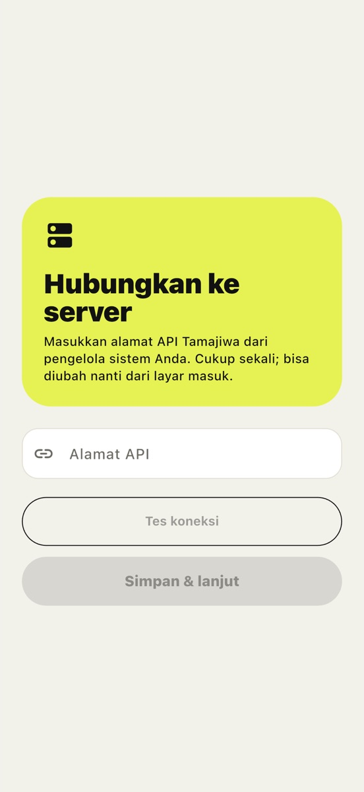
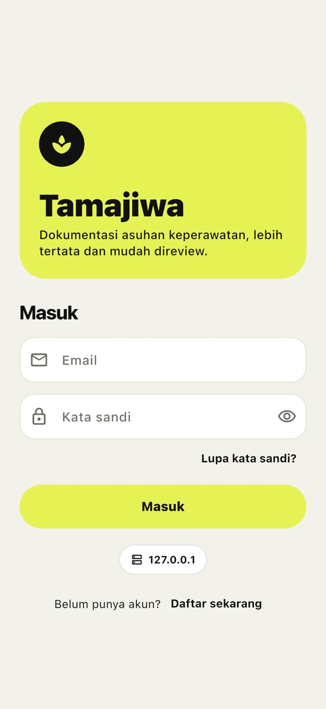
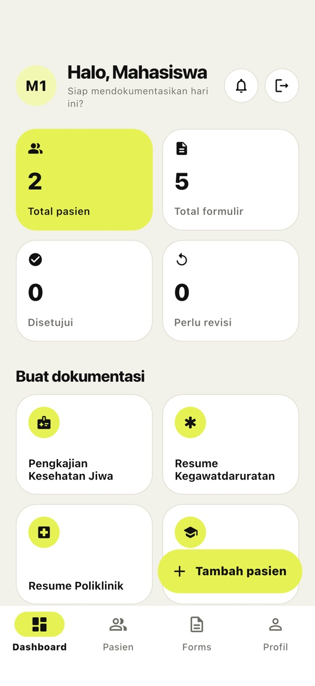
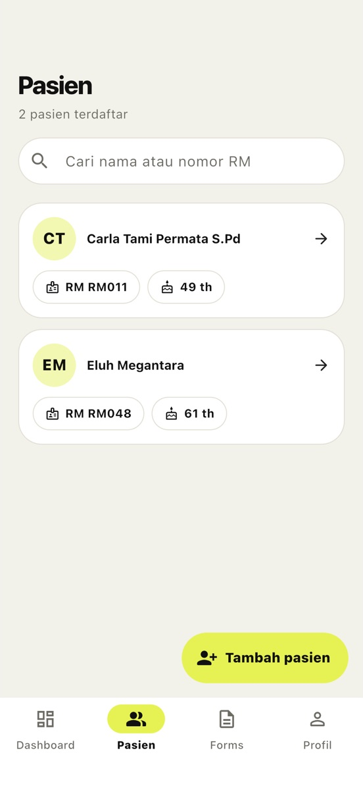
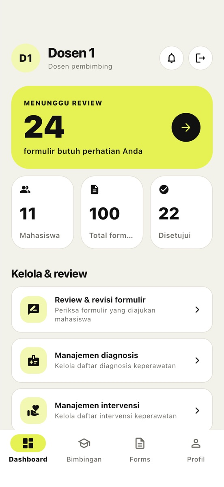
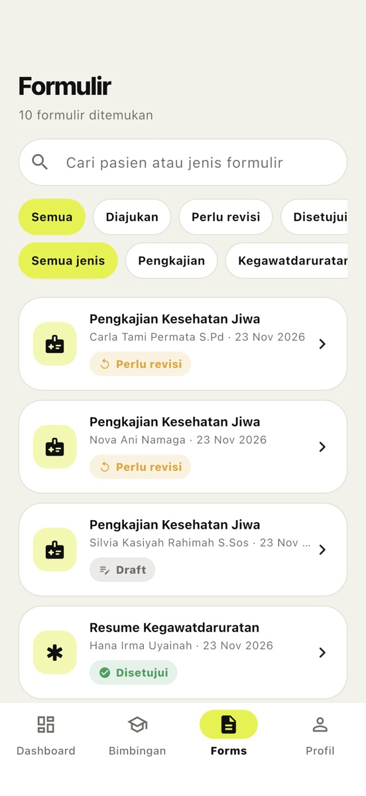

<div align="right">

[English](README.md) · **Bahasa Indonesia**

</div>

# Tamajiwa: dokumentasi asuhan keperawatan

[](https://flutter.dev)
[](https://laravel.com)

Aplikasi mobile dan API untuk **mahasiswa keperawatan dan dosennya** mendokumentasikan asuhan pasien. Mahasiswa mencatat pasien dan mengisi formulir keperawatan baku; dosen mengelola pustaka diagnosis dan intervensi, mereviu formulir yang diajukan, dan memantau mahasiswa bimbingannya.

## Fitur

- **Peran:** mahasiswa dan dosen, dengan alur penugasan dosen dan dashboard per peran.
- **Pasien:** membuat dan mengelola pasien yang ditangani mahasiswa.
- **Formulir:** pengkajian, strategi pelaksanaan komunikasi (SAP), terapi aktivitas kelompok (TAK), resume poliklinik dan kegawatdaruratan, serta catatan tambahan. Foto dan materi dapat dilampirkan.
- **Pembuat genogram:** menyusun genogram keluarga di aplikasi dan menampilkannya sebagai SVG.
- **Pustaka keperawatan:** diagnosis dan intervensi yang dikelola dosen.
- **Review dan PDF:** dosen mereviu formulir yang diajukan dan hanya melihat mahasiswa bimbingannya; formulir dapat diekspor ke PDF.
- **Komentar per bagian:** dosen memberi komentar pada bagian formulir tertentu saat meminta revisi; mahasiswa menandai komentar yang sudah diperbaiki.
- **Notifikasi dalam aplikasi:** lonceng dengan badge belum dibaca memberi tahu dosen soal pengajuan baru, dan mahasiswa soal persetujuan atau permintaan revisi. Tidak ada push; daftar diperbarui saat dashboard ditarik atau dibuka lagi.
- **Nilai:** dosen dapat memberi nilai 0–100 saat mereviu; mahasiswa melihatnya di formulir dan dosen melihat rata-rata tiap mahasiswa.
- **Progres mahasiswa:** dosen melihat kelengkapan tujuh jenis formulir tiap mahasiswa bimbingan.
- **Draf otomatis:** isian formulir baru tersimpan di perangkat dan dipulihkan saat dibuka lagi.
- **Desain:** tema terang dan gelap dengan komponen bersama di `lib/widgets/ds/`.
- **Reset password:** permintaan dan reset lewat tautan email.

## Tangkapan layar

Diambil dari aplikasi sungguhan terhadap backend lokal yang di-seed, dengan data demo buatan Faker.

| Hubungkan server | Masuk | Dashboard mahasiswa |
|---|---|---|
|  |  |  |

| Mahasiswa: pasien | Dashboard dosen | Dosen: formulir untuk direviu |
|---|---|---|
|  |  |  |

## Teknologi

| Bagian | Teknologi |
|---|---|
| Aplikasi | Flutter, Dart, GetX, Hive |
| API | Laravel 12, Sanctum, SQLite (bawaan) atau database Laravel lain |
| Pengujian | `flutter test`, PHPUnit |
| CI | GitHub Actions |

## Memulai

### 1. Backend

```bash
cd backend
composer install
cp .env.example .env
php artisan key:generate
touch database/database.sqlite
php artisan migrate
php artisan serve          # http://127.0.0.1:8000
```

Isi `DB_CONNECTION=sqlite` di `.env` untuk memulai paling cepat. Email memakai driver `log`, sehingga tautan reset password muncul di `storage/logs/laravel.log`.


### Akun demo

`php artisan migrate:fresh --seed` membuat data fiktif (50 pasien, sekitar 100 formulir, diagnosis, dan intervensi). Semua akun memakai password `password`:

| Peran | Email |
|---|---|
| Dosen | `dosen1@example.com` … `dosen5@example.com` |
| Mahasiswa | `mahasiswa1@example.com` … `mahasiswa10@example.com` |

Mahasiswa ditugaskan ke dosen secara bergilir (Mahasiswa 1 dan 6 milik Dosen 1, dan seterusnya), sehingga layar dosen berisi data.

### 2. Aplikasi

```bash
flutter pub get
flutter run
```

#### Mengarahkan aplikasi ke server

Saat pertama dibuka, aplikasi meminta alamat API, jadi pengguna akhir cukup menempelkannya. Aplikasi menguji `GET {alamat}/health-check`, menyimpan alamat di perangkat, lalu menampilkan layar masuk. Alamat bisa diubah lagi lewat chip server di bagian bawah layar masuk. Input dirapikan otomatis: `api.contoh.id` menjadi `https://api.contoh.id/api`, dan IP atau `localhost` memakai `http://`.

Urutan prioritas: alamat yang disimpan di aplikasi, lalu `--dart-define=API_BASE_URL=https://server-anda.example/api` saat build, lalu bawaan lokal (`http://127.0.0.1:8000/api`, atau `10.0.2.2` di emulator Android). Bila `--dart-define` diisi, permintaan alamat saat pertama dibuka dilewati.

Alamat `http://` biasa diblokir pada build rilis Android; gunakan `https://` kecuali untuk pengembangan lokal.

## Pengujian

```bash
flutter analyze && flutter test
cd backend && php artisan test
```

Pemeriksaan menyeluruh dan tangkapan layar (backend berjalan dan ter-seed, simulator menyala):

```bash
flutter drive --driver=test_driver/integration_test.dart \
  --target=integration_test/e2e_test.dart -d <id-simulator> --dart-define=ROLE=mahasiswa   # atau dosen
```

## Catatan keamanan

- Jangan commit berkas `.env`, arsip, atau database lokal; semuanya sudah ada di `.gitignore`.
- Alamat server tidak disimpan di kode. Berikan saat build.
- Proyek ini menangani catatan asuhan pasien. Pakai data fiktif untuk demo dan ikuti aturan institusi untuk data sungguhan.

## Penulis

**Rizky Eka Haryadi**  
[GitHub](https://github.com/Rizky28eka) · [LinkedIn](https://www.linkedin.com/in/rizky28eka/) · [Portofolio](https://heyeka.vercel.app)
