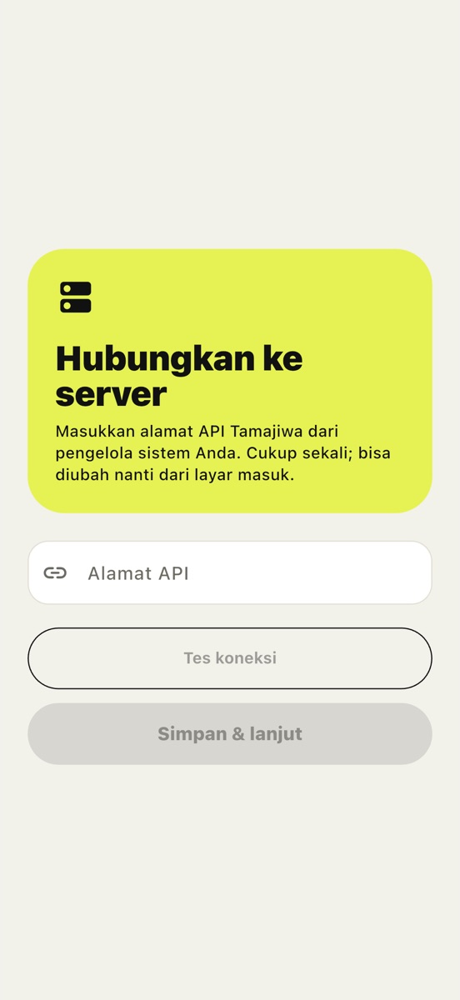
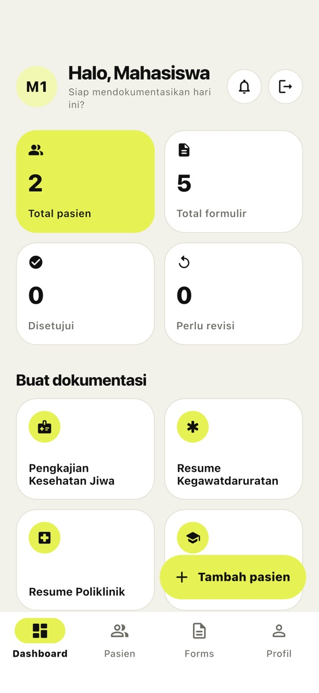
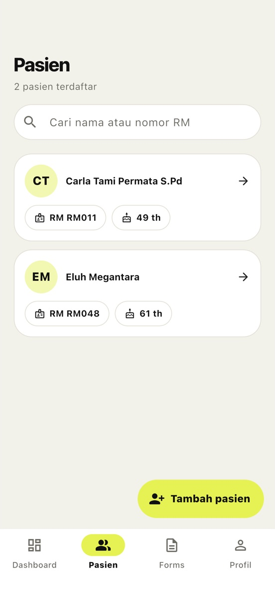
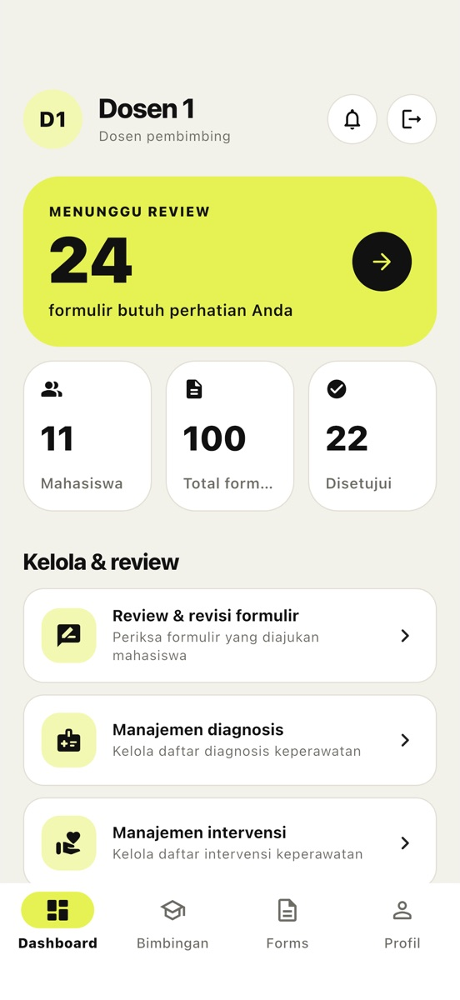
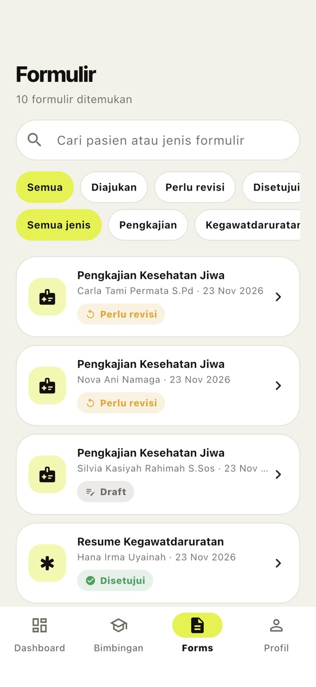

<div align="right">

**English** · [Bahasa Indonesia](README.id.md)

</div>

# Tamajiwa: nursing care documentation

[](https://flutter.dev)
[](https://laravel.com)

A mobile app and API for **nursing students and their lecturers** to document patient care. Students (*mahasiswa*) record patients and fill in the standard nursing forms; lecturers (*dosen*) manage the diagnosis and intervention libraries, review submitted forms, and track the students assigned to them.

## Features

- **Roles:** students and lecturers, with a lecturer assignment flow and per-role dashboards.
- **Patients:** create and manage the patients a student is working with.
- **Forms:** assessment (*pengkajian*), communication strategy (SAP), group activity therapy (TAK), outpatient and emergency resumes, and extra notes. Photos and materials can be attached.
- **Genogram builder:** build a family genogram in the app and render it as SVG.
- **Nursing libraries:** diagnoses and interventions maintained by lecturers.
- **Review and PDF:** lecturers review submitted forms from their own students only; forms can be exported to PDF.
- **Section comments:** lecturers comment on specific form sections when requesting a revision; students tick off comments once fixed.
- **In-app notifications:** a bell with an unread badge tells lecturers about new submissions and students about approvals and revision requests. There is no push delivery; the list refreshes when the dashboard is pulled down or reopened.
- **Scores:** lecturers can give a 0–100 score when reviewing; students see it on the form and lecturers see each student's average.
- **Student progress:** lecturers see how many of the seven form types each student has completed.
- **Draft autosave:** new form input is kept on the device and restored when the form is reopened.
- **Design:** light and dark themes with shared components in `lib/widgets/ds/`.
- **Password reset:** request and reset by email link.

## Screenshots

Captured from the real app against a locally seeded backend, using Faker-generated demo data.

| Server setup | Sign in | Student dashboard |
|---|---|---|
|  |  |  |

| Student: patients | Lecturer dashboard | Lecturer: forms to review |
|---|---|---|
|  |  |  |

## Tech stack

| Area | Technology |
|---|---|
| App | Flutter, Dart, GetX, Hive |
| API | Laravel 12, Sanctum, SQLite (default) or any Laravel database |
| Tests | `flutter test`, PHPUnit |
| CI | GitHub Actions |

## Getting started

### 1. Backend

```bash
cd backend
composer install
cp .env.example .env
php artisan key:generate
touch database/database.sqlite
php artisan migrate
php artisan serve          # http://127.0.0.1:8000
```

Set `DB_CONNECTION=sqlite` in `.env` for the quickest start. Mail uses the `log` driver by default, so password-reset links appear in `storage/logs/laravel.log`.


### Demo accounts

`php artisan migrate:fresh --seed` creates fictional data (50 patients, about 100 forms, diagnoses and interventions). All accounts use the password `password`:

| Role | Email |
|---|---|
| Lecturer | `dosen1@example.com` … `dosen5@example.com` |
| Student | `mahasiswa1@example.com` … `mahasiswa10@example.com` |

Students are assigned to lecturers in turn (Mahasiswa 1 and 6 belong to Dosen 1, and so on), so the lecturer screens have data.

### 2. App

```bash
flutter pub get
flutter run
```

#### Pointing the app at a server

On first launch the app asks for the API address, so end users only need to paste it in. It checks `GET {address}/health-check`, saves the address on the device, and then shows the sign-in screen. The address can be changed later from the server chip at the bottom of the sign-in screen. Input is tidied for you: `api.example.id` becomes `https://api.example.id/api`, and bare IPs or `localhost` use `http://`.

Order of precedence: address saved in the app, then `--dart-define=API_BASE_URL=https://your-server.example/api` at build time, then the local default (`http://127.0.0.1:8000/api`, or `10.0.2.2` on the Android emulator). Setting a `--dart-define` skips the first-launch prompt.

Plain `http://` addresses are blocked by Android release builds; use `https://` for anything but local development.

## Testing

```bash
flutter analyze && flutter test
cd backend && php artisan test
```

End-to-end check and screenshots (backend running and seeded, simulator booted):

```bash
flutter drive --driver=test_driver/integration_test.dart \
  --target=integration_test/e2e_test.dart -d <simulator-id> --dart-define=ROLE=mahasiswa   # or dosen
```

## Security notes

- Never commit `.env` files, archives or local databases; they are ignored in `.gitignore`.
- The app stores no server address in the source. Provide it at build time.
- This project handles patient-care records. Use fictional data for demos and follow your institution's rules for real data.

## Author

**Rizky Eka Haryadi**  
[GitHub](https://github.com/Rizky28eka) · [LinkedIn](https://www.linkedin.com/in/rizky28eka/) · [Portfolio](https://heyeka.vercel.app)
